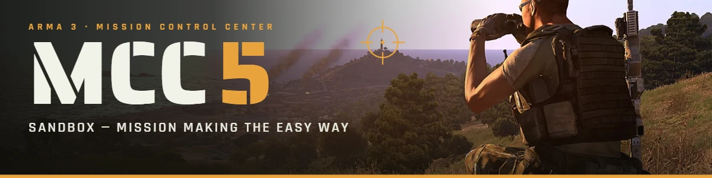

# MCC Sandbox 5 — Mission Control Center for Arma 3

Mission making the easy way: build and run missions in the Eden editor and Zeus, with the GAIA AI commander.

**Download:** [latest release (ARMA3-MCC5.zip)](https://github.com/haganahzion/Arma3-MCC5/releases/download/ARMA3-MCC5/ARMA3-MCC5.zip) · Requires **CBA_A3** · Install steps: [INSTALL.md](INSTALL.md)

- **Eden:** top menu **MCC 5** — mission settings, Mission Wizard that generates the whole mission in the editor, MCC modules.
- **Zeus:** **MCC 5** button — every MCC tool, plus *GAIA: Control Group* (AI work through the tasks on their own).
- **GAIA AI:** fast AI commander; uses vehicles, coordinates attacks, calls artillery, CAS and reinforcements.
- **Optional mods detected automatically:** ACE3, RHS, CUP, LAMBS Danger / Suppression, HBQ Advanced Driving AI.
- **Optional limited logistics:** fuel, ammo and repair run out and must be resupplied.

Changelog: [MCC_changelog.txt](MCC_changelog.txt)
